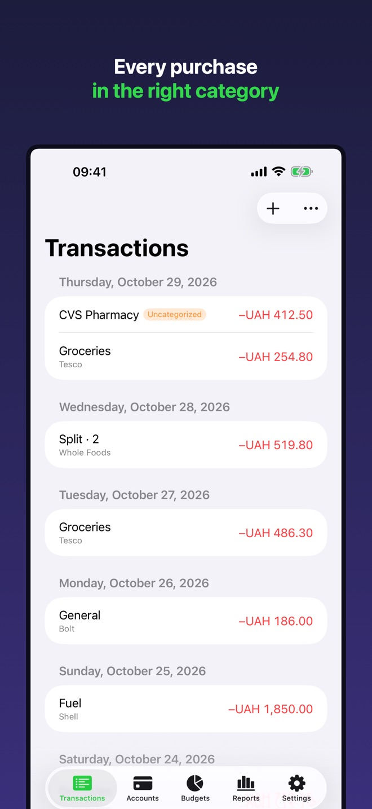
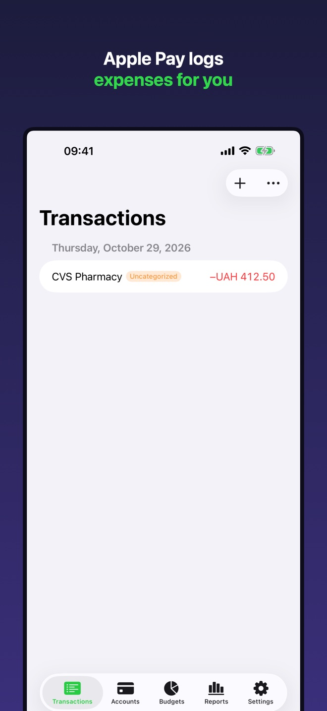
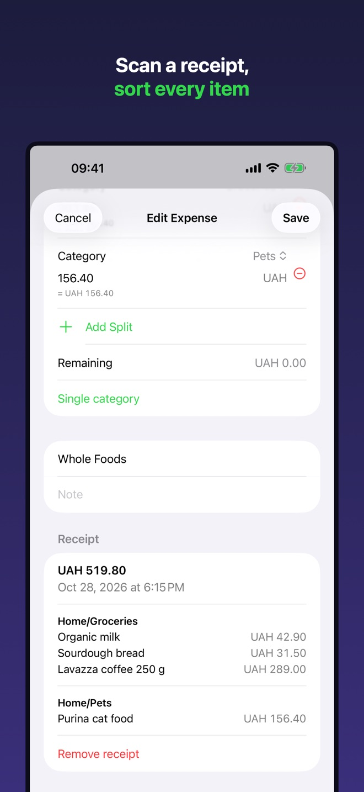
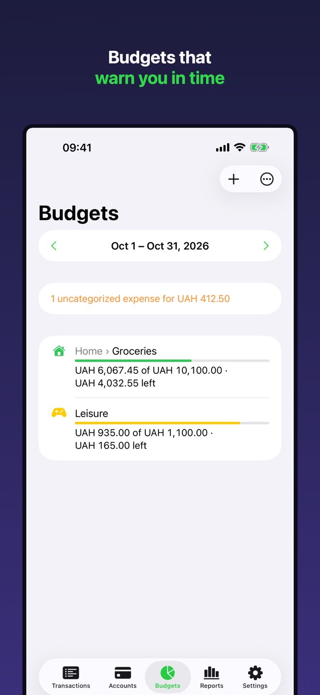
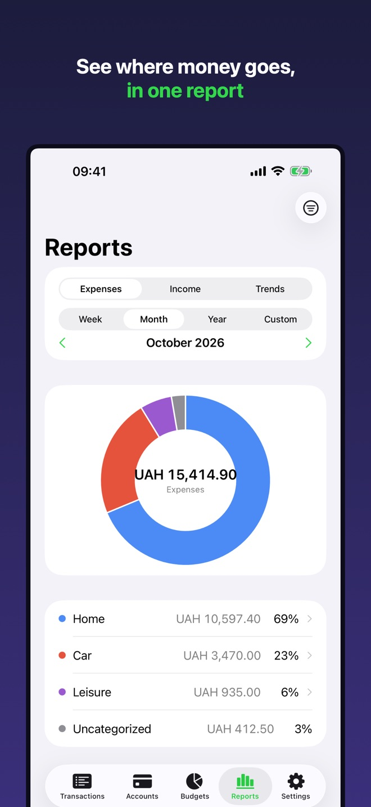

# Debit Credit

**Budget, expenses, receipts.** Personal budgeting for iPhone, iPad and Mac with no accounts and no tracking.

| | |
|---|---|
| App Store name | Debit&Credit: Budget, Expenses |
| Category | Finance · Free · 4+ |
| Languages | English, Ukrainian |
| Platforms | iPhone, iPad, Mac |
| Source code | [kovteba/ios_debit_credit_app](https://github.com/kovteba/ios_debit_credit_app) |

## Links (GitHub Pages)

| Page | URL |
|---|---|
| Presentation / Support | https://kovteba.github.io/ios_app/debit-credit/ |
| Privacy Policy (EN) | https://kovteba.github.io/ios_app/debit-credit/privacy-en.html |
| Privacy Policy (UK) | https://kovteba.github.io/ios_app/debit-credit/privacy.html |

## Screenshots

  
  
  
  
  

1. Every purchase in the right category
2. Apple Pay logs expenses for you
3. Scan a receipt, sort every item
4. Budgets that warn you in time
5. See where money goes, in one report

Full-size App Store screenshots: [`screenshots/`](screenshots) (`iphone`, `ipad`, `mac` × `en`, `uk`). Captions: [`screenshots/captions.json`](screenshots/captions.json).

## Features

- **Apple Pay logs expenses for you.** A one-time Shortcuts automation adds every Apple Pay payment with amount and payee; payee rules pick the category.
- **Receipt scanning.** Camera, Photos or Files; recognised on device; every item gets its own category.
- **Categories and subcategories.** Ready-made set, custom icons and colours, split transactions.
- **Accounts in any currency.** NBU exchange rates or manual; total balance in the main currency.
- **Transfers** between own accounts, including currency exchange.
- **Budgets** per week / month / year / custom period, alerts at 80% and 100%.
- **Reports and trends.** By category, income vs expenses, month by month.
- **Privacy.** No ads, analytics or tracking; data on device and optionally in private iCloud.

## Folder contents

| Path | What |
|---|---|
| `index.html` | Presentation and support page |
| `privacy.html`, `privacy-en.html` | Privacy Policy (UK, EN) |
| `style.css` | Styles for the pages |
| `app-store/en.md`, `app-store/uk.md` | App Store Connect texts: name, subtitle, description, keywords |
| `app-store/privacy-answers.md` | App Privacy and export-compliance answers |
| `icon/` | App icon (SVG: default, dark, tinted) |
| `screenshots/` | App Store screenshots and web previews |
